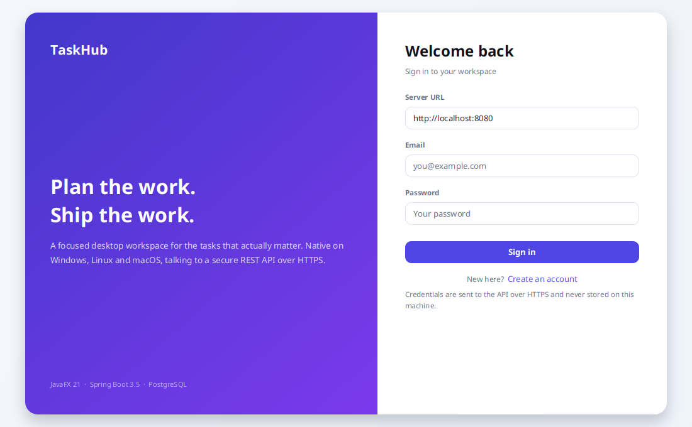
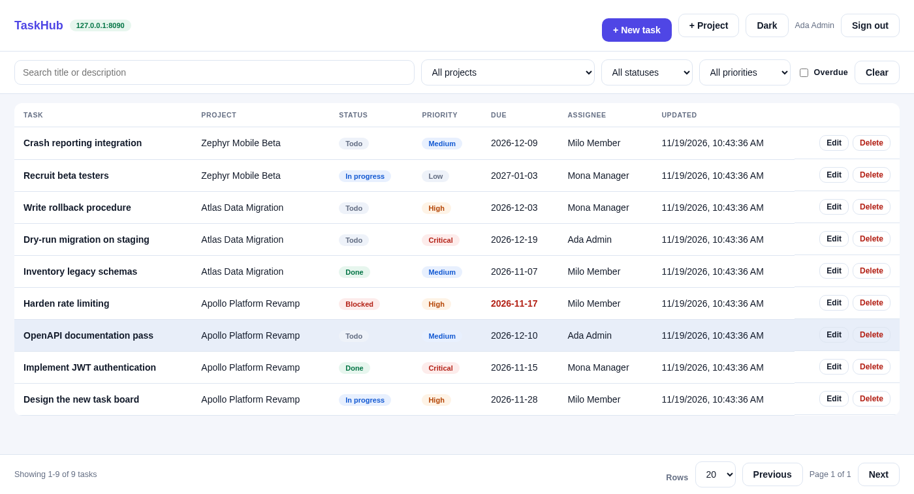

# TaskHub

A production-shaped CRUD platform: **JavaFX desktop client → HTTPS REST API (Spring Boot) →
PostgreSQL**, with JWT auth, row-level authorization, pagination/search/filter/sort, migrations,
tests, containers, CI/CD and a working browser client.

| Desktop (JavaFX 21) | Browser (optional SPA) |
|---|---|
|  |  |

---

## Contents

1. [What is implemented](#1-what-is-implemented)
2. [Verified evidence](#2-verified-evidence)
3. [Architecture](#3-architecture)
4. [Quick start](#4-quick-start)
5. [Project structure](#5-project-structure)
6. [Configuration](#6-configuration)
7. [API](#7-api)
8. [Testing](#8-testing)
9. [Desktop build & distribution](#9-desktop-build--distribution)
10. [Deployment & the public URL](#10-deployment--the-public-url)
11. [Security](#11-security)
12. [Known limits / roadmap](#12-known-limits--roadmap)

---

## 1. What is implemented

**Backend (Spring Boot 3.5.16, Java 21, PostgreSQL 16, Flyway)**
- Full CRUD for **projects** and **tasks**, plus project membership and user administration.
- **Auth**: registration, login, refresh-token **rotation with reuse detection**, logout, `/me`.
- **Authorization**: global roles (ADMIN/MANAGER/MEMBER) and per-project roles
  (OWNER/CONTRIBUTOR/VIEWER) enforced in one service-layer guard.
- **Querying**: 0-based pagination with a clamped page size, allow-listed sorting, case-insensitive
  search with escaped wildcards, filters (status, priority, project, assignee, overdue).
- **Validation**: Bean Validation with per-field error payloads; domain invariants (owner cannot be
  removed, last admin protected, assignee must be a project member).
- **Concurrency**: optimistic locking (`version` → `409 STALE_VERSION`).
- **Errors**: one stable envelope with machine-readable `code` and `X-Request-Id` correlation.
- **Security**: BCrypt cost 12, HS256 JWT with startup secret validation, rate limiting on
  credential endpoints, CORS allow-list, security headers, no stack traces in responses.
- **Ops**: Flyway migrations, health/liveness/readiness probes, metrics, ECS-structured logs,
  Docker image (non-root), graceful shutdown, scheduled token purge.
- **Docs**: OpenAPI 3 + Swagger UI at `/swagger-ui.html`.

**Desktop (JavaFX 21.0.13)**
- Native Windows/Linux/macOS client with a modern light/dark theme, responsive table, debounced
  search, server-side sort by column click, filters, pagination, task and project CRUD dialogs,
  toasts, empty/loading/error states, keyboard shortcuts, and transparent token refresh.
- Zero database access; the same jar works against any deployment.

**Browser client (vanilla JS, no build step)** — login **and open self-service sign-up**, task and
project CRUD, search/filter/sort/pagination, dark mode. Served by nginx in the Compose stack and
by Spring Boot at `/` on the Fly deployment, with a strict CSP and same-origin API.

**Delivery**: multi-stage Dockerfiles, docker-compose, Fly/Render/Railway configs, GitHub Actions
CI (build + tests + container builds) and deploy workflow, backup/restore scripts, smoke test,
docs for architecture, API, deployment, security and operations.

---

## 2. Verified evidence

Everything below was executed in this workspace, not asserted:

| Check | Result |
|---|---|
| Backend `mvn verify` | **39 tests** — 11 unit (JWT, bootstrap admin) + 28 integration (auth flows, CRUD, filters, pagination, sorting, RBAC, 401/403/409/429) |
| Real PostgreSQL 15 run | Flyway migrated, `ddl-auto=validate` passed, seeded dev data served over HTTP |
| `scripts/smoke-test.sh` | 30 assertions green: health, OpenAPI, login, project/task CRUD, search, filters, sort, overdue, validation, cascade delete, token rotation + replay rejection |
| Desktop `mvn verify` | 11 tests (transport via a stub HTTP server, FXML wiring contract) |
| JavaFX UI smoke (Xvfb) | login + workspace loaded with real API data, screenshots captured (both themes) |
| Browser SPA (Chromium + Selenium) | login → list → create → search → delete → theme → logout, all green |
| Static config checks | all YAML/JSON parse; `node --check` on the SPA; no inline scripts |

Reproduce the backend + smoke test:

```bash
cd backend && mvn -B verify
cd .. && BASE_URL=http://localhost:8080 EMAIL=admin@taskhub.local PASSWORD='Admin@12345' \
  ./scripts/smoke-test.sh
```

---

## 3. Architecture

```
┌──────────────────────┐        ┌───────────────────────┐
│  JavaFX desktop      │        │  Browser SPA          │
│  Windows/Linux/macOS │        │  (optional, nginx)    │
└──────────┬───────────┘        └───────────┬───────────┘
           │      HTTPS · JSON · JWT        │
           └───────────────┬────────────────┘
                           ▼
              ┌─────────────────────────────┐
              │  Spring Boot 3.5 REST API   │  stateless → scale out freely
              │  Security · Validation · JPA│
              └──────────────┬──────────────┘
                             │ JDBC (pooled, TLS in prod)
                             ▼
                     ┌───────────────┐
                     │  PostgreSQL   │  Flyway-managed schema
                     └───────────────┘
```

Design decisions, alternatives considered and the ADR log: **[docs/ARCHITECTURE.md](docs/ARCHITECTURE.md)**.
Notably: a JavaFX application is a native process and **cannot run in a browser**; browser access is
provided by the separate SPA that consumes the identical REST contract.

---

## 4. Quick start

### Option A — Docker (recommended first run)

```bash
cp .env.example .env
printf 'TASKHUB_JWT_SECRET=%s\n' "$(openssl rand -base64 48)" >> .env
# optional first admin: edit .env (TASKHUB_BOOTSTRAP_ADMIN_EMAIL / _PASSWORD)
docker compose up -d --build
curl -fsS http://localhost:8080/actuator/health | jq
```

- API → <http://localhost:8080> · Swagger UI → <http://localhost:8080/swagger-ui.html>
- Browser client → <http://localhost:8081>

### Option B — local dev with hot reload

```bash
# 1. PostgreSQL (skip if you already have one)
docker run -d --name taskhub-pg -e POSTGRES_DB=taskhub -e POSTGRES_USER=taskhub \
  -e POSTGRES_PASSWORD=taskhub -p 5432:5432 postgres:16-alpine

# 2. API on :8080 with demo data (dev profile)
cd backend && mvn spring-boot:run -Dspring-boot.run.profiles=dev

# 3. Desktop client
cd desktop && mvn javafx:run
```

Dev seed accounts (dev profile only — never in production):

| Email | Password | Role |
|---|---|---|
| `admin@taskhub.local` | `Admin@12345` | ADMIN |
| `manager@taskhub.local` | `Manager@12345` | MANAGER |
| `member@taskhub.local` | `Member@12345` | MEMBER |

### Option C — connect the desktop client to a remote API

```bash
cd desktop
mvn javafx:run -Djavafx.args="--api=https://your-api.fly.dev"
# or: TASKHUB_API_URL=https://your-api.fly.dev mvn javafx:run
# or: type the URL into the "Server URL" field on the login screen
```

---

## 5. Project structure

```
taskhub/
├── backend/                     Spring Boot API
│   ├── src/main/java/com/taskhub/
│   │   ├── auth/                login, refresh rotation, reuse detection, cleanup job
│   │   ├── user/                users, roles, admin endpoints
│   │   ├── project/             projects, membership, ProjectAccess (row-level authz)
│   │   ├── task/                tasks, specifications, filters
│   │   ├── security/            JWT service, auth filter, principal
│   │   ├── config/              security, CORS, OpenAPI, rate limit, bootstrap, demo seed
│   │   └── common/              ApiError, PageResponse, PageableFactory, exception handler
│   ├── src/main/resources/
│   │   ├── db/migration/V1__init.sql
│   │   └── application{,-dev,-prod,-test}.yml
│   └── Dockerfile
├── desktop/                     JavaFX client (api/ auth/ ui/ util/ config/)
├── web/                         optional browser SPA + nginx config
├── docs/                        ARCHITECTURE · API · DEPLOYMENT · SECURITY · RUNBOOK
├── scripts/                     smoke-test · backup · restore · fly-deploy
├── .github/workflows/           ci.yml · deploy.yml
├── docker-compose.yml · fly.toml · render.yaml · railway.json
└── Makefile
```

---

## 6. Configuration

Every setting is environment-based; production has **no security-relevant defaults**.

| Variable | Required | Default | Purpose |
|---|---|---|---|
| `TASKHUB_JWT_SECRET` | **prod** | dev-only value | Base64, ≥ 32 bytes decoded. Startup fails if weak. |
| `TASKHUB_DB_URL` | yes | `jdbc:postgresql://localhost:5432/taskhub` | JDBC URL (`?sslmode=require` in prod) |
| `TASKHUB_DB_USER` / `TASKHUB_DB_PASSWORD` | yes | `taskhub` | DB credentials |
| `TASKHUB_DB_POOL_SIZE` | no | `10` | Hikari pool size per instance |
| `TASKHUB_CORS_ORIGINS` | if browser | `http://localhost:5173,http://localhost:8081` | Comma-separated origins |
| `TASKHUB_ACCESS_TOKEN_TTL` | no | `PT15M` | Access token lifetime |
| `TASKHUB_REFRESH_TOKEN_TTL` | no | `P7D` | Refresh token lifetime |
| `TASKHUB_RATE_LIMIT_ENABLED` / `_ATTEMPTS` / `_WINDOW` | no | `true` / `10` / `PT5M` | Credential endpoint limiter |
| `TASKHUB_BOOTSTRAP_ADMIN_EMAIL` / `_PASSWORD` / `_NAME` | first run | – | Creates the first ADMIN if none exists |
| `TASKHUB_OPENAPI_ENABLED` | no | `true` | Set `false` to hide Swagger UI in production |
| `TASKHUB_LOG_LEVEL` | no | `INFO` | Application log level |
| `TASKHUB_HEALTH_DETAILS` | no | `never` (prod) | Health component details |
| `SPRING_PROFILES_ACTIVE` | no | – | `dev` or `prod` |
| `PORT` | no | `8080` | HTTP port |

Desktop client: `--api=`, `TASKHUB_API_URL`, `-Dtaskhub.api.url`, or the login screen field
(saved to `~/.taskhub/desktop.properties`).

Full table and platform specifics: **[docs/DEPLOYMENT.md](docs/DEPLOYMENT.md)**.

---

## 7. API

Base path `/api/v1`. Full reference with curl examples and every error code:
**[docs/API.md](docs/API.md)**. Interactive: **`/swagger-ui.html`**.

```bash
API=http://localhost:8080
TOKEN=$(curl -sS -X POST $API/api/v1/auth/login -H 'Content-Type: application/json' \
  -d '{"email":"admin@taskhub.local","password":"Admin@12345"}' | jq -r .accessToken)

# Create a project, then a task
PID=$(curl -sS -X POST $API/api/v1/projects -H "Authorization: Bearer $TOKEN" \
  -H 'Content-Type: application/json' \
  -d '{"code":"APOLLO","name":"Apollo","status":"ACTIVE"}' | jq -r .id)

curl -sS -X POST $API/api/v1/tasks -H "Authorization: Bearer $TOKEN" \
  -H 'Content-Type: application/json' \
  -d "{\"projectId\":\"$PID\",\"title\":\"Ship 1.0\",\"priority\":\"HIGH\",\"dueDate\":\"2026-04-01\"}" | jq

# Search + filter + sort + paginate
curl -sS "$API/api/v1/tasks?search=ship&priority=HIGH&sort=dueDate&direction=asc&page=0&size=20" \
  -H "Authorization: Bearer $TOKEN" | jq '.totalElements, .content[0].title'
```

Error responses are uniform:

```json
{"timestamp":"2026-02-11T09:12:33Z","status":400,"code":"VALIDATION_FAILED",
 "message":"Request validation failed","path":"/api/v1/tasks","requestId":"…",
 "fieldErrors":[{"field":"title","message":"must not be blank"}]}
```

---

## 8. Testing

```bash
# Backend: unit + integration (H2 in PostgreSQL mode, same Flyway SQL as production)
cd backend && mvn -B verify

# Desktop: transport + FXML wiring
cd desktop && mvn -B verify

# Desktop UI smoke against a running API (needs a display)
TASKHUB_UI_TEST=1 xvfb-run -a mvn -B test -Dtest=UiSmokeTest

# End-to-end HTTP smoke (works against localhost or a public deployment)
BASE_URL=http://localhost:8080 ./scripts/smoke-test.sh

# Browser SPA smoke (Chromium + Selenium)
python3 work/spa_proxy.py 8090 http://127.0.0.1:8080 &
python3 work/spa_smoke.py
```

Test design notes:
- Integration tests hit the **real filter chain** and commit like production (no shared test
  transaction), which is what exposed two real bugs during development: bulk-update stale
  persistence contexts, and a revocation being rolled back by the 401 it raised.
- `*IT` classes run under Failsafe (`mvn verify`); `*Test` under Surefire (`mvn test`).

---

## 9. Desktop build & distribution

```bash
cd desktop
mvn -B package        # target/taskhub-desktop.jar (shaded, includes JavaFX natives for this OS)
java -jar target/taskhub-desktop.jar --api=https://your-api.example.com
```

Build once per OS (JavaFX ships platform-specific natives; CI does this on Ubuntu). Native
installers via `jpackage` — exact commands in [desktop/README.md](desktop/README.md).

---

## 10. Deployment & the public URL

The repository contains everything required to produce a public HTTPS endpoint:

| Target | How |
|---|---|
| Fly.io | `./scripts/fly-deploy.sh` (provisions Postgres, sets secrets, deploys, health-checks) |
| Render | Import `render.yaml` as a Blueprint |
| Railway | `railway up` with `railway.json` |
| Any VPS | `docker compose up -d` behind Caddy/nginx |

**Live now:** **https://crud-app-metbxg.fly.dev** — open it in a browser for the web client, or
point the desktop app's *Server URL* at the same host. Deploy verified end-to-end on Fly.io
(`iad`, PostgreSQL 16 on a persistent volume, HTTPS + HSTS, Swagger UI at `/swagger-ui.html`).
`scripts/smoke-test.sh` passes fully against it, and a stop/start cycle preserved all data.
Deployment record and the all-in-one rationale: [docs/DEPLOYMENT.md](docs/DEPLOYMENT.md#live-deployment-this-repository).

Step-by-step instructions (including the first-admin bootstrap, HTTPS, health checks, backups and
monitoring): **[docs/DEPLOYMENT.md](docs/DEPLOYMENT.md)**.

---

## 11. Security

Design, threat model, accepted risks and hardening checklist: **[docs/SECURITY.md](docs/SECURITY.md)**.

Highlights: BCrypt cost 12 · rotating single-use refresh tokens with family revocation · server-side
row-level authorization · allow-listed sort fields · escaped LIKE search · rate limiting · strict
error contract · non-root container · no secrets in git · CSP for the SPA.

Operational procedures: **[docs/RUNBOOK.md](docs/RUNBOOK.md)**.

---

## 12. Known limits / roadmap

- No browser-hosted JavaFX (by design); the SPA is the browser path.
- Access tokens remain valid up to 15 minutes after logout (stateless design) — add a `jti`
  deny-list if instant revocation is required.
- Rate limiting is per instance; use Redis or edge limits for multi-instance deployments.
- Contains-search is a sequential scan; add the documented `pg_trgm` index beyond ~10⁵ tasks.
- No email verification, password reset, MFA, attachments or audit trail yet.
- Self-service sign-up is **on by default** (new accounts get `MEMBER`, rate limited to 10
  attempts / 5 min / IP). Close it at any time with `TASKHUB_REGISTRATION_ENABLED=false` — no
  code change, no redeploy of the client.
- Project rename/delete/membership UI is desktop + API only (the SPA covers task CRUD).

---

## License

MIT — see `LICENSE`. Replace the placeholder maintainer details before publishing.
