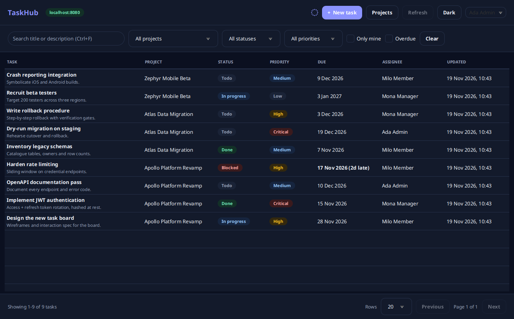

# TaskHub Desktop (JavaFX)

Native client for Windows, Linux and macOS. It talks to the REST API over HTTPS and holds no
database credentials.



## Requirements

- JDK 21 (Temurin/Microsoft/Corretto all work)
- Maven 3.9+
- A reachable TaskHub API (local `docker compose up` or a deployed URL)

JavaFX itself is pulled from Maven Central — no manual SDK install.

## Run

```bash
cd desktop
mvn javafx:run
```

Point it at a server in one of four ways (first match wins):

| Source | Example |
|---|---|
| CLI flag | `mvn javafx:run -Djavafx.args="--api=https://taskhub-api.fly.dev"` |
| Environment | `TASKHUB_API_URL=https://taskhub-api.fly.dev mvn javafx:run` |
| System property | `-Dtaskhub.api.url=https://...` |
| In-app field | Type it into **Server URL** on the login screen (saved after a successful login) |

## Build

```bash
mvn -B package            # target/taskhub-desktop.jar (shaded, per-OS JavaFX natives)
mvn -B verify             # tests: API client + FXML wiring contract
```

The fat jar includes the JavaFX native libraries for the OS it was built on, so build once per
target platform (use the CI matrix or a VM). Run it with:

```bash
java -jar target/taskhub-desktop.jar --api=https://your-api.example.com
```

### Native installers (optional)

`jpackage` produces `.msi` / `.dmg` / `.deb` without extra tooling:

```bash
# Linux/macOS
mvn -B package
jpackage --type app-image \
  --name TaskHub \
  --input target \
  --main-jar taskhub-desktop.jar \
  --main-class com.taskhub.desktop.TaskHubClient \
  --java-options "-Dfile.encoding=UTF-8"

# Windows (MSI)
jpackage --type msi --name TaskHub --input target ^
  --main-jar taskhub-desktop.jar --main-class com.taskhub.desktop.TaskHubClient ^
  --win-shortcut --win-dir-chooser
```

Ship the resulting image/installer through your normal software distribution channel.

## Features

- Login + self-service registration (registration button opens a dialog; password rules mirrored
  from the server)
- Task list with server-side pagination, sorting (click column headers), case-insensitive search
  (debounced), project/status/priority filters, "only mine", "overdue"
- Create / edit / delete tasks in dialogs with client-side validation and optimistic concurrency
  (`version` echoed back → `409 STALE_VERSION` surfaces as a toast)
- Project management dialog with full CRUD and ownership-aware actions
- Light/dark theme toggle, remembered between launches
- Keyboard: `Ctrl+N` new task, `Ctrl+F` focus search, `F5` refresh, `Esc` clear filters
- Loading, empty and error states; toasts for every server outcome; session auto-refresh on `401`

## Architecture

```
ui/         FXML views + controllers (view state only)
  └── api/  typed HTTP client: ApiClient, Query, Dtos, Requests
        └── auth/SessionManager: token lifecycle + single-flight refresh
config/     AppContext (manual DI), AppConfig (URL + preferences)
util/       Async (FX-thread marshalling), UiUtils (formatting/confirm)
```

No FXML view contains HTTP code, and no controller touches `java.net.http` directly.

## Tests

```bash
mvn test                                    # 11 tests: transport + FXML contract
TASKHUB_UI_TEST=1 xvfb-run -a mvn test -Dtest=UiSmokeTest   # real toolkit + live API
```

`UiSmokeTest` needs a running API (defaults `http://localhost:8080`, override with
`TASKHUB_UI_URL`, `TASKHUB_UI_EMAIL`, `TASKHUB_UI_PASSWORD`) and writes screenshots to
`target/ui-screenshots/`.

## Troubleshooting

| Symptom | Fix |
|---|---|
| `Cannot reach http://localhost:8080` | Start the API (`docker compose up -d api`) |
| Blank window on Linux | Ensure GTK3 is installed; `libgtk-3-0 libxtst6` |
| `JavaFX runtime components are missing` | Run via `mvn javafx:run`, or use the shaded jar |
| Self-signed HTTPS | Import the certificate into the JVM truststore (`-Djavax.net.ssl.trustStore=...`) |
