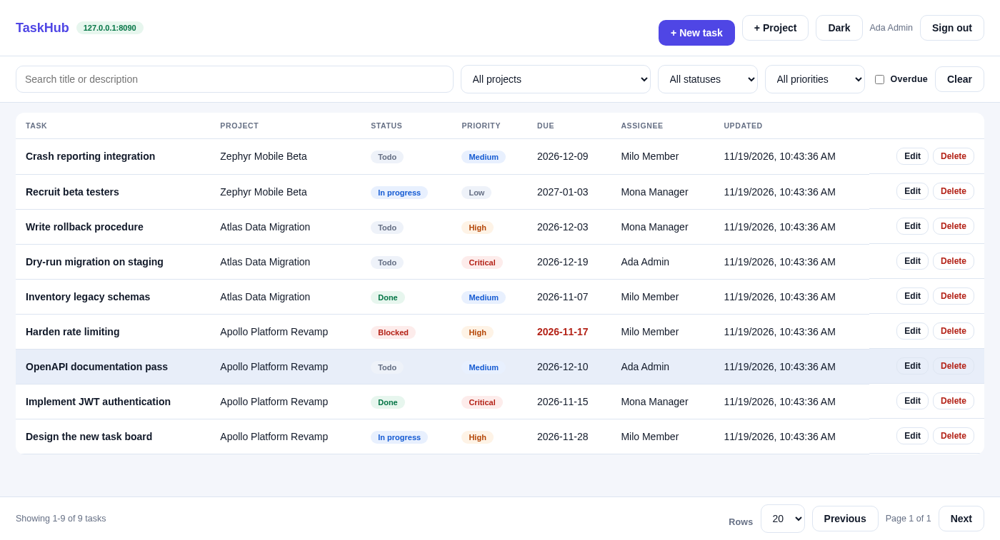

# TaskHub Web (optional browser client)

A browser cannot run JavaFX. This small single-page client exists so the same REST API is
reachable from any browser, using the same accounts and permissions as the desktop app.



## Run

It is served by nginx in the Compose stack:

```bash
docker compose up -d --build
open http://localhost:8081
```

For local development without Docker, serve the folder and proxy `/api` to the backend
(`work/spa_proxy.py` in this repository does exactly that):

```bash
python3 work/spa_proxy.py 8090 http://127.0.0.1:8080
open http://127.0.0.1:8090
```

You can also host the three static files on any static host and point the **Server URL** field at
your API; in that case add the static host's origin to `TASKHUB_CORS_ORIGINS`.

## Design notes

- No build step, no third-party runtime requests, ~15 KB of JS.
- Tokens live in memory only — a reload requires signing in again. This removes the persistent
  XSS token-theft path that `localStorage` would create.
- All server data is rendered with `textContent`, never `innerHTML`.
- nginx sets a strict CSP (`script-src 'self'`), `frame-ancestors 'none'`, `nosniff`, and a
  same-origin `/api` proxy so no CORS is involved.
- Feature parity for the CRUD paths: list/search/filter/sort/paginate, create, edit, delete, and
  project creation.
- Self-service sign-up: "Create an account" on the login card (display name, email, password +
  confirmation), with the server's validation rules mirrored client-side. New accounts start as
  `MEMBER` with no access to anyone else's projects; close signups with
  `TASKHUB_REGISTRATION_ENABLED=false`.

## Limitations

- No offline mode, no drag-and-drop, no keyboard shortcuts (the desktop client is the richer UX).
- Project rename/delete/membership management is desktop- and API-only today.
